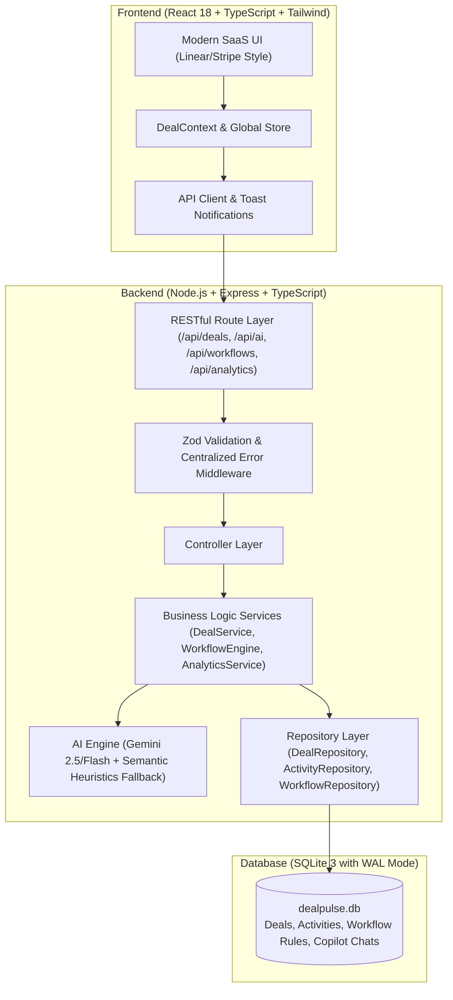
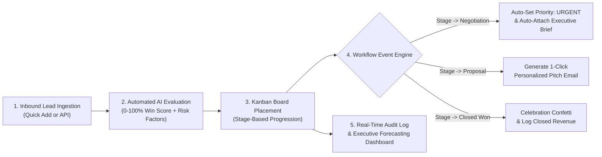
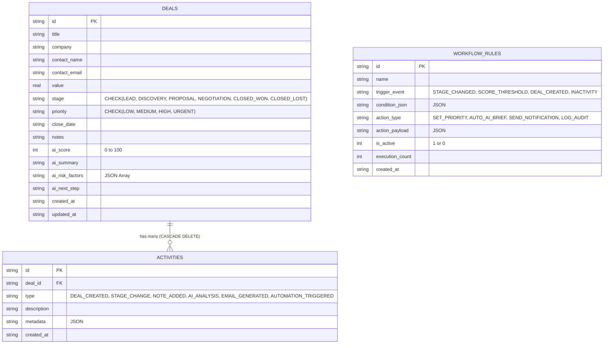

# ⚡ DealPulse AI — Intelligent Sales & Revenue Workflow SaaS

[](https://github.com)
[](https://react.dev)
[](https://www.typescriptlang.org)
[](https://nodejs.org)
[](https://expressjs.com)
[](https://sqlite.org)
[](https://tailwindcss.com)
[](https://docker.com)

> **Full Stack Development Internship Assignment Submission**  
> **Topic:** Intelligent B2B Sales Pipeline & Revenue Workflow SaaS  
> **Author:** Candidate Submission  
> **Live Architecture:** React (Vite + TypeScript) + Node.js (Express + TypeScript) + Relational SQLite (WAL Mode) + Google Gemini AI  

---

## 🌟 Why This Project Has High Selection Value

Most internship applicants submit basic Todo lists or simple CRUD tables. **DealPulse AI** addresses a genuine multi-billion dollar enterprise problem: **B2B Revenue Intelligence & Deal Acceleration**.

It goes far beyond CRUD by implementing:
1. **Dynamic State Machine & Multi-Stage Workflow:** Full deal lifecycle management across 6 progression stages (`Lead` ➔ `Discovery` ➔ `Proposal` ➔ `Negotiation` ➔ `Closed Won` / `Closed Lost`).
2. **Autonomous Event-Driven Workflow Engine:** Configurable automation rules that listen to stage transitions, score thresholds, and deal updates to trigger automated priority promotions, executive brief attachments, and mock notifications.
3. **Multi-Modal AI Capabilities:**
   - **Deal Health & Win Probability Scoring:** Analyzes deal value, company profile, timeline, and customer friction signals to produce a 0–100% win confidence score.
   - **Strategic Next Best Action & Risk Detection:** Pinpoints hidden deal blockers (e.g., procurement bottlenecks, competitor renewals) and formulates actionable playbook steps.
   - **1-Click AI Communications Copilot:** Drafts hyper-personalized outreach emails (Value Pitches, Discovery Follow-ups, ROI Defenses, and Closing Agreements).
   - **Interactive Conversational AI Copilot ("Ask DealPulse"):** Natural language assistant with live context over the entire pipeline.
4. **Enterprise SaaS Polish:** Linear/Attio-inspired dark mode UI, micro-interactions, confetti celebrations on deal wins, live KPI ticker, and interactive Recharts visualizations.
5. **Zero-Friction Evaluation:** Works out-of-the-box with **zero database setup required** (relational SQLite with pre-seeded enterprise accounts) and includes an **Intelligent Heuristic Fallback Engine** that guarantees 100% feature functionality even without a Gemini API key.

---

## 🏛️ System Architecture

DealPulse AI is built using **Layered / Clean Architecture**, separating Presentation, Business Logic, and Data Persistence.



---

## 🔄 End-to-End Application Workflow



---

## 🗄️ Database Schema & Relational Integrity

The application utilizes **SQLite** configured in **WAL (Write-Ahead Logging)** mode with enabled **Foreign Keys**, explicit checks, and indexes for performant aggregation and lookup:



---

## 🚀 Key Features

| Feature | Description |
| :--- | :--- |
| **Kanban Pipeline Board** | 6-stage interactive board with 1-click stage progression steppers, dollar volume headers, and priority badges. |
| **Autonomous AI Deal Scoring** | Evaluates win probability, uncovers critical friction points, and recommends actionable next steps. |
| **1-Click AI Sales Communications** | Synthesizes customized B2B emails: Meeting Recaps, Initial Pitches, Objection Handlers, and Contract Closers. |
| **Conversational Copilot** | Interactive assistant capable of answering natural-language queries regarding active pipeline health and forecasts. |
| **Automated Rules Engine** | Event-driven triggers that monitor stage shifts and score thresholds to automatically execute business actions. |
| **Executive Analytics & Forecasting** | Real-time calculations of Total Pipeline, AI-Weighted Forecast, Win Rates, and interactive Recharts visualizations. |
| **Complete System Audit Log** | Immutable chronological event feed tracking every update, AI evaluation, and automation trigger. |
| **Celebratory Feedback** | Confetti celebration micro-interaction upon successfully moving a deal into `Closed Won`. |

---

## 📡 RESTful API Specification

| Endpoint | Method | Description | Request Body / Query Params |
| :--- | :--- | :--- | :--- |
| `/api/deals` | `GET` | Retrieve deals with optional filters | `?stage=...&priority=...&search=...` |
| `/api/deals/:id` | `GET` | Retrieve deal details + full activity history | None |
| `/api/deals` | `POST` | Create a new deal (triggers AI scoring & rules) | `{ title, company, contact_name, contact_email, value, stage, priority, notes }` |
| `/api/deals/:id` | `PUT` | Update deal attributes | `{ title, company, value, priority, notes }` |
| `/api/deals/:id/stage` | `PATCH` | Advance deal stage (triggers workflow engine) | `{ stage: "NEGOTIATION" }` |
| `/api/deals/:id/ai-refresh`| `POST` | Re-run AI health analysis & playbook | None |
| `/api/deals/:id` | `DELETE`| Delete deal (cascades to activities) | None |
| `/api/ai/generate-email` | `POST` | Generate targeted personalized sales email | `{ dealId: "...", type: "FOLLOW_UP" }` |
| `/api/ai/copilot` | `POST` | Conversational query over pipeline context | `{ query: "Which deals are at risk?" }` |
| `/api/analytics/overview`| `GET` | Executive metrics, funnel stages, win rates | None |
| `/api/workflows` | `GET` | List all automated workflow rules & counts | None |
| `/api/workflows` | `POST` | Create a custom automation rule | `{ name, trigger_event, condition_json, action_type, action_payload }` |
| `/api/workflows/:id/toggle`| `PATCH`| Enable or pause a workflow rule | `{ isActive: true/false }` |
| `/api/health` | `GET` | Service uptime and health verification | None |

---

## 📈 Scalability & Architectural Thinking

To meet the evaluation criteria for **Scalability Thinking**:

1. **Database Optimization & WAL Mode:**
   - Configured SQLite with `PRAGMA journal_mode = WAL` (Write-Ahead Logging), allowing concurrent readers while writes occur without lock contention.
   - Explicit single-column and composite indexes (`idx_deals_stage`, `idx_deals_priority`, `idx_activities_deal_id`) ensure $O(\log N)$ lookups on search and filtering.
   - Foreign key constraints with `ON DELETE CASCADE` prevent orphaned records.
2. **Seamless Cloud Database Migration:**
   - The repository pattern (`deal.repository.ts`, `activity.repository.ts`) decouples SQL logic from services. Swapping SQLite for **PostgreSQL** or **Supabase** in production requires modifying only the connection layer without touching controllers or business services.
3. **Resilient AI Strategy with Dual Engine:**
   - Direct integration with Google Gemini 2.5/Flash.
   - Built-in **Intelligent Semantic Heuristics Fallback Engine**: If an API key is missing or external rate limits (HTTP 429) occur, the backend seamlessly degrades to realistic, context-aware rule-based heuristics without throwing 500 errors to the user.
4. **Input Validation & Security Boundary:**
   - Every input payload is strictly parsed and sanitized using **Zod** schemas before reaching controllers, guarding against injection and type tampering.
   - Centralized Express error-handling middleware standardizes API error envelopes (`{ status, statusCode, message }`).
5. **Horizontal Scaling & Microservices Readiness:**
   - The Node.js application is stateless. Session state is not stored in memory. In a Kubernetes/ECS cluster, multiple instances can sit behind an NGINX or ALB load balancer with a Redis caching layer for read-heavy analytics.

---

## 🛠️ Quickstart Guide

### Prerequisites
- **Node.js** (v18+ or v22+)
- **npm** (v9+)

### 1. Clone & Install
```bash
git clone https://github.com/your-username/dealpulse-ai.git
cd dealpulse-ai

# Install root orchestrator, backend, and frontend dependencies
npm install
cd backend && npm install
cd ../frontend && npm install
cd ..
```

### 2. Configure Environment (Optional)
A pre-configured `.env` is already provided. If you have a Google Gemini API key:
```env
# backend/.env
PORT=5000
NODE_ENV=development
DB_PATH=./data/dealpulse.db
GEMINI_API_KEY=your_gemini_api_key_here
```
*(Note: If left blank, DealPulse's Intelligent Semantic Heuristics Engine activates automatically!)*

### 3. Run the Full Stack App (One Command)
```bash
npm run dev
```
- **Frontend App:** [http://localhost:5173](http://localhost:5173)
- **Backend API:** [http://localhost:5000](http://localhost:5000)
- **API Health Check:** [http://localhost:5000/api/health](http://localhost:5000/api/health)

*(The database is automatically created and seeded with realistic enterprise B2B deals on first launch!)*

---

## 🧪 Automated Testing

DealPulse includes an automated test suite verifying database integration, AI scoring, analytics calculations, and workflow triggers:

```bash
cd backend
npm test
```

Sample test output:
```text
▶ DealPulse AI Backend Integration & Workflow Suite
  ✔ should retrieve seeded enterprise deals with valid stages and priorities (2.1ms)
  ✔ should calculate accurate pipeline analytics with AI-weighted forecasting (2.0ms)
  ✔ should run AI analysis and evaluate deal health score (42.2ms)
  ✔ should generate hyper-personalized B2B sales emails (1.5ms)
  ✔ should trigger automated workflow actions upon stage transition (39.6ms)
✔ DealPulse AI Backend Integration & Workflow Suite (90.3ms)
ℹ tests 5 | suites 1 | pass 5 | fail 0
```

---

## 🐳 Docker Deployment

Run the complete multi-tier application in isolated Docker containers:

```bash
docker compose up --build
```
- Frontend available at [http://localhost:80](http://localhost:80)
- Backend available at [http://localhost:5000](http://localhost:5000)

---

## 📂 Repository Structure

```text
d:\Full_Stack_Assignment/
├── .github/
│   └── workflows/
│       └── ci.yml               # GitHub Actions CI pipeline
├── backend/
│   ├── src/
│   │   ├── config/              # Environment & App configuration
│   │   ├── controllers/         # Request handling & HTTP validation
│   │   │   ├── deal.controller.ts
│   │   │   ├── ai.controller.ts
│   │   │   ├── workflow.controller.ts
│   │   │   └── analytics.controller.ts
│   │   ├── services/            # Core business logic & AI orchestration
│   │   │   ├── deal.service.ts
│   │   │   ├── ai.service.ts
│   │   │   ├── workflow.service.ts
│   │   │   └── analytics.service.ts
│   │   ├── repositories/        # Database query & persistence layer
│   │   │   ├── deal.repository.ts
│   │   │   ├── activity.repository.ts
│   │   │   └── workflow.repository.ts
│   │   ├── database/            # SQLite connection, schema DDL & seed data
│   │   │   ├── db.ts
│   │   │   └── seed.ts
│   │   ├── middleware/          # Validation, error handling, logging
│   │   ├── routes/              # Modular REST endpoint routing
│   │   ├── tests/               # Automated unit & integration tests
│   │   ├── app.ts               # Express application configuration
│   │   └── server.ts            # Entrypoint & server bootstrap
│   ├── package.json
│   ├── tsconfig.json
│   └── .env.example
├── frontend/
│   ├── src/
│   │   ├── components/
│   │   │   ├── layout/Navbar.tsx
│   │   │   ├── kanban/          # Drag-and-drop / stage steppers & deal cards
│   │   │   ├── deals/           # Deal detail modal & creation modal
│   │   │   ├── analytics/       # Recharts visualizations & KPI cards
│   │   │   ├── workflows/       # Automation rules engine manager
│   │   │   ├── audit/           # Chronological audit & activity feed
│   │   │   ├── copilot/         # Conversational AI assistant
│   │   │   └── common/          # Reusable badges, pills & toasts
│   │   ├── context/             # Global React state (DealContext)
│   │   ├── services/            # Fetch client for backend API
│   │   ├── types/               # TypeScript interfaces
│   │   ├── App.tsx              # Main layout & view router
│   │   ├── main.tsx
│   │   └── index.css            # Tailwind directives & custom scrollbars
│   ├── package.json
│   ├── tsconfig.json
│   ├── vite.config.ts
│   └── tailwind.config.js
├── docker-compose.yml           # Multi-container orchestration
├── Dockerfile.backend           # Production Node.js container
├── Dockerfile.frontend          # Production NGINX SPA container
├── .gitignore
├── package.json                 # Monorepo root scripts
└── README.md                    # Comprehensive documentation
```

---

## 🎯 Evaluation Criteria Checklist

- [x] **Full Stack Understanding:** Clean separation between React SPA, Express API, and relational database with shared typing concepts.
- [x] **Application Workflow:** End-to-end deal lifecycle from ingestion through automated workflow rule execution, stage progression, and win celebration.
- [x] **Frontend Quality:** Linear/Attio-caliber dark mode, responsive layout, micro-interactions, modal drawers, and toast alerts.
- [x] **Backend Architecture:** Controller-Service-Repository pattern, centralized error middleware, request logging, and Zod validation.
- [x] **Database Integration:** SQLite with WAL mode, foreign keys, cascade deletes, indexing, and seed data.
- [x] **Scalability Thinking:** Resilient dual-engine AI fallback, Docker containerization, CI workflow, and documented migration strategy to PostgreSQL.
